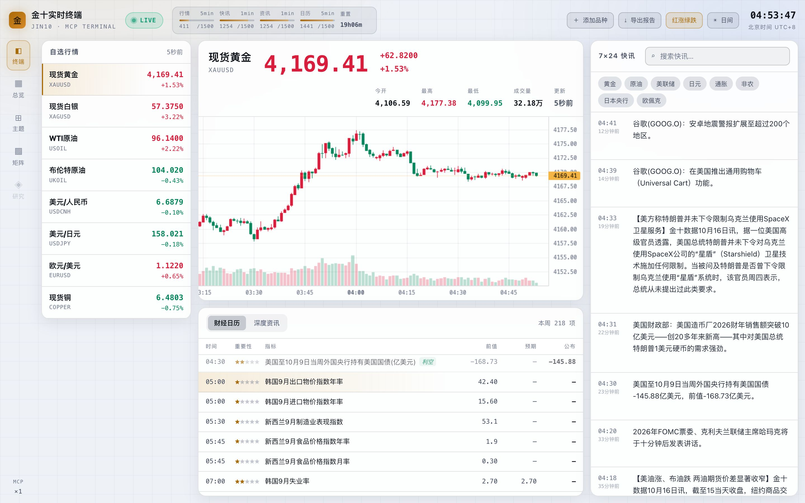
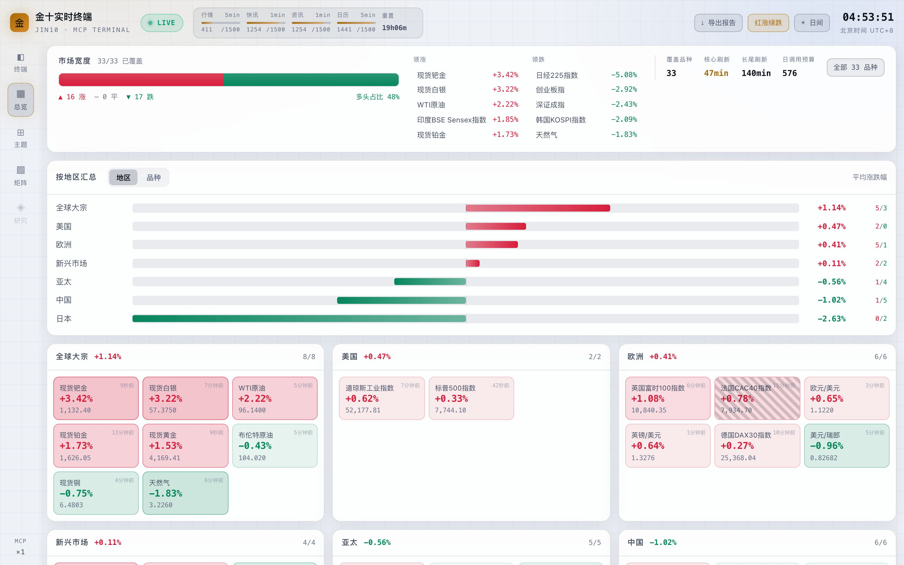
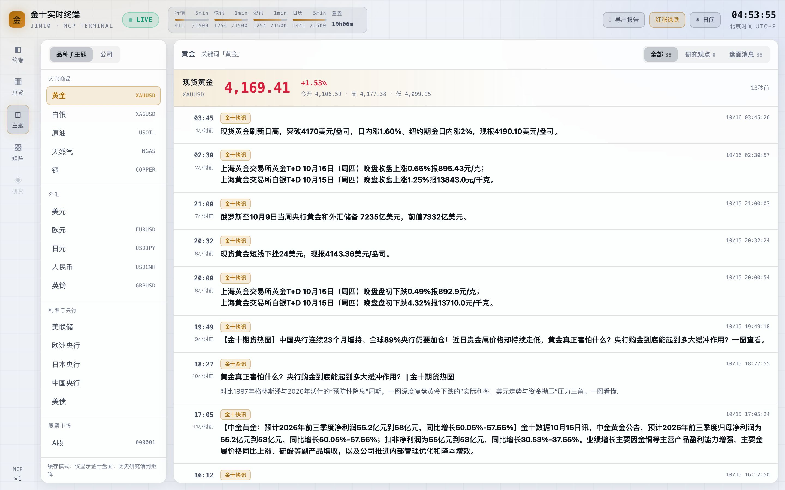
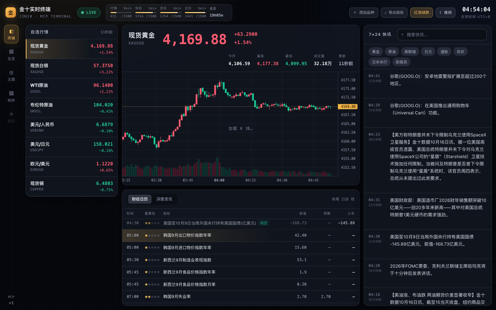
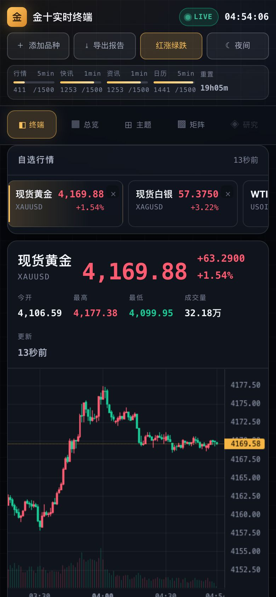
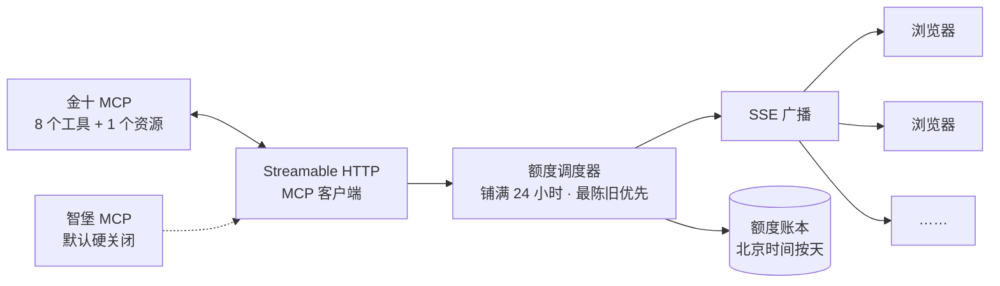

<div align="center">

# 金十实时终端 · JIN10 MCP TERMINAL

**每个工具每天只有 1500 次调用，也能 24 小时不断档的实时财经终端。**

通过标准 MCP 协议接入[金十数据](https://mcp.jin10.com)：行情、分钟 K 线、7×24 快讯、深度资讯、财经日历，<br>
一个 Node 进程同时做 MCP 客户端、额度调度器、SSE 广播器和前端托管，本机、Docker、Railway 都能跑。

[**60 秒无密钥体验**](#60-秒无密钥体验) &nbsp;·&nbsp; [它怎么工作](#它怎么工作) &nbsp;·&nbsp; [部署](#部署) &nbsp;·&nbsp; [安全与数据合规](#安全与数据合规)


</div>

<p align="center"></p>

## 为什么做

金十 MCP 的限制是**每个工具每天 1500 次调用**，这和“实时”直接冲突：1 秒轮询一次，25 分钟就把当天额度烧光。
整套架构都围绕这个约束设计，目标是**额度永不提前断供，界面如实显示刷新代价**。

| 手段 | 效果 |
|---|---|
| **服务端单例轮询 + SSE 扇出** | 100 个浏览器和 1 个浏览器消耗完全相同的额度 |
| **额度铺满调度** | `86400s ÷ (1500 × 0.9) = 64 秒/次`，把日额度摊平到 24 小时 |
| **双通道并行** | `get_quote` 与 `get_kline` 各有 1500 次，合计约 32 秒一次调用 |
| **加权最陈旧优先** | 宏观锚（黄金、原油、美元、美股、中国）刷得快，长尾慢慢补 |
| **在途请求合并** | 同一秒 10 个页面点开同一根 K 线，只算 1 次真实调用 |
| **持久化额度账本** | 按北京时间自然日计数，重启、重新部署后接着当天的计数 |

## 看一眼

<table>
<tr>
<td width="50%"><br><sub><b>总览</b>：市场宽度、领涨领跌、按地区或品种汇总、分组热力矩阵（超时数据打斜纹）</sub></td>
<td width="50%"><br><sub><b>主题工作台</b>：24 个宏观交易主题，顶部直接给出对应品种的实时报价</sub></td>
</tr>
</table>

<p align="center">
&nbsp;
<br>
<sub>日间 / 夜间、红涨绿跌 / 绿涨红跌随时切换；手机端横向自选、宽屏三栏并行</sub>
</p>

## 能做什么

| 模块 | 说明 |
|---|---|
| **终端** | 自选行情（报价跳动闪烁）、分钟级 K 线（北京时间轴，实时价推动最后一根蜡烛）、7×24 快讯流（关键词搜索与热词）、财经日历（星级重要性、利多利空，自动定位下一个待公布）、深度资讯全文 |
| **总览** | 市场宽度条、领涨领跌榜、按地区或品种汇总的发散条形图、分组热力矩阵、覆盖度面板（当前刷新间隔、整轮周期、日调用预算） |
| **主题工作台** | 品种 / 主题与公司两种分面；主题对应可交易品种时给出实时报价，一点跳到终端看 K 线 |
| **研究矩阵** | 把智堡研究沉淀成本地 SQLite 库：断点续传同步、从原文抽取可追溯结论、主题 × 观点二维矩阵、中文全文检索 |
| **一键导出报告** | HTML（可打印成 PDF）、Markdown、JSON 三种格式；用内存快照生成，**不消耗任何金十额度** |
| **额度水位** | 顶栏常驻每个工具的已用 / 上限和重置倒计时 |

## 它怎么工作



**覆盖范围与刷新率的取舍**：这是硬算术，界面上如实显示，不做粉饰。

```
2700 次/天 ÷ 288 次（5 分钟刷新一个品种所需） ≈ 9
```

**24 小时不间断 + 5 分钟刷新，最多只能覆盖 9 个品种。** 所以提供两档，随时可切：

| 档位 | 覆盖 | 核心品种刷新 | 长尾刷新 |
|---|---|---|---|
| **核心** | 9 个宏观锚 | **约 4.6 分钟** | 不覆盖 |
| **全部**（默认） | 33 个品种 | 约 10 分钟 | 约 31 分钟 |

快讯 / 资讯 / 日历各有独立的 1500/天，按 64 秒轮询只用掉 90%，全天候无压力。

<details>
<summary><b>MCP 接入实现细节</b></summary>

`server/src/mcp/client.ts` 是一个从零实现的 **Streamable HTTP** MCP 客户端，不依赖 `mcp-remote` 之类的 stdio 桥接。

**握手流程**（严格按协议）：

```
initialize → notifications/initialized → tools/list / resources/list → tools/call
```

- 协议版本 `2025-11-25`
- 认证：`Authorization: Bearer <token>`
- 会话：从 `initialize` 响应头取 `mcp-session-id`，后续请求带上；服务端不下发时自动降级为无状态模式
- 响应体同时支持 `application/json` 与 `text/event-stream`（金十走 SSE 单响应流）
- **服务端推送通道**：`GET /mcp` 长连接接收 `notifications/*`，支持 `Last-Event-ID` 断点续传与指数退避重连
- 会话失效（HTTP 404 / JSON-RPC `-32001`）自动重新握手并重放一次原请求

**两个数据源的关键差异**：

|  | 金十 | 智堡 |
|---|---|---|
| 服务 | `mcp-server v1.0.0` | `wisburg-mcp v0.7.0` |
| 工具数 | 8 | 11 |
| 资源 | `quote://codes` | 无 |
| 会话 | 下发 `mcp-session-id` | 无状态 |
| **结果格式** | **`structuredContent`**（机器解析主来源） | **仅 `content[0].text`**（markdown，需解析） |
| 分页 | `cursor` → `next_cursor` / `has_more` | `first` + `after` → `Next cursor: N` |

> 金十官方文档的示例写的是 `next_offset`，且快讯 item 带 `id`/`title`。**线上实际返回是 `next_cursor`，快讯只有 `content`/`time`/`url`。**
> 本项目按线上实测实现，并对文档里的可选字段做了容错。
> 另外文档未提及 `list_calendar`，但线上 `tools/list` 确实存在且可用，本项目实现的是文档的超集。

**已接入的全部工具**

金十（8/8）：`get_quote` `get_kline` `list_flash` `search_flash` `list_news` `search_news` `get_news` `list_calendar`
资源：`quote://codes`

智堡（11/11）：`list-feed` `list-market-daily` `list-articles` `get-article-detail` `list-images` `list-institutional-reports` `list-company-reports` `list-am-reports` `list-archive-reports` `list-earning-calls` `get-report-detail`

</details>

## 60 秒无密钥体验

推荐 Node 22（仓库含 `.nvmrc`），最低 Node 20。

```bash
npm ci
npm run demo        # 打开 http://localhost:8080
```

页面会明确显示 `DEMO`，使用本地确定性演示数据，不访问金十或智堡，也不消耗任何额度。另开一个终端可做端到端探测：`npm run probe`。

**接真实数据**：复制 `.env.example` 为 `.env`，填写 `JIN10_TOKEN`（金十 MCP 的 Bearer Token），然后：

```bash
npm run dev                  # 开发：server :8080 + Vite :5173
npm run build && npm start   # 生产：同一进程托管前端 → http://localhost:8080
npm run verify               # 类型检查 + 生产构建 + 内置测试
```

## 部署

| 方式 | 入口 | 适用场景 |
|---|---|---|
| 单进程 | `npm run build && npm start` | VPS、Windows 服务、macOS / Linux 本机 |
| Docker | `docker compose up --build` | 任意容器平台；默认持久化额度账本 |
| Railway | `railway up` | 仓库内置 Nixpacks 与健康检查配置 |
| 前后端分离 | `VITE_API_BASE_URL` + `CORS_ORIGIN` | 静态 CDN 前端 + 独立 API 服务 |

健康检查：`GET /api/health`。GitHub Actions 在 Ubuntu（Node 20 / 22）和 Windows（Node 22）上跑 `npm run verify`。

<details>
<summary><b>Docker</b></summary>

无密钥验收：

```bash
DEMO_MODE=true docker compose up --build
```

PowerShell：

```powershell
$env:DEMO_MODE = "true"
docker compose up --build
```

实盘运行：先从 `.env.example` 创建 `.env` 并填写密钥，再运行：

```bash
docker compose up --build -d
BASE_URL=http://localhost:8080 npm run probe
```

Compose 会把 `terminal-data` 卷挂载到 `/app/data`。迁移机器时应同时迁移该卷，否则 Matrix 数据和当天额度计数都会丢失。

</details>

<details>
<summary><b>Railway 与环境变量</b></summary>

```bash
railway link                                        # 关联项目
railway volume add --mount-path /app/data --json    # 首次部署缓存库时先建卷
railway volume files upload .data/wisburg-matrix.sqlite /wisburg-matrix.sqlite --json
railway up                                          # 数据到位后再部署
```

`volume files upload` 的远端路径以卷根目录 `/` 计算；应用通过挂载点 `/app/data/wisburg-matrix.sqlite` 读取。上传前先确认本地 SQLite `PRAGMA quick_check` 返回 `ok`。数据库已被 `.gitignore` 与 `.dockerignore` 排除，普通 `git push`、GitHub 构建或 `railway up` 都不会替你迁移它。

`volume files upload` 的远端路径以卷根目录 `/` 计算；应用通过挂载点 `/app/data/wisburg-matrix.sqlite` 读取。上传前先确认本地 SQLite `PRAGMA quick_check` 返回 `ok`。数据库已被 `.gitignore` 与 `.dockerignore` 排除，普通 `git push`、GitHub 构建或 `railway up` 都不会替你迁移它。

在 Railway 的 **Variables** 面板配置（**不要**提交 `.env`）：

| 变量 | 必需 | 说明 |
|---|:--:|---|
| `JIN10_TOKEN` | ✅ | 金十 MCP Bearer Token |
| `WISBURG_LIVE_ENABLED` | ✅ | 缓存专用部署固定为 `false`；旧 token 单独存在也不会连接 |
| `WISBURG_TOKEN` | | 缓存专用部署不需要；权限恢复前建议从平台删除 |
| `STATE_DIR` | ✅ | 缓存专用部署填 `/tmp/jin10-state`；避免额度账本写入只读卷 |
| `MATRIX_DB_PATH` | ✅ | 填 `/app/data/wisburg-matrix.sqlite` |
| `MATRIX_READ_ONLY` | ✅ | 缓存专用部署固定为 `true`；卷上源库不写，运行时使用临时只读副本 |
| `WISBURG_MATRIX_AUTO_SYNC` | ✅ | 缓存专用部署固定为 `false` |
| `MATRIX_PUBLIC_CONTENT` | | 默认 `false`，公网不返回缓存全文 |
| `MATRIX_ADMIN_TOKEN` | | Bearer Token；不公开全文时用于受控读取 |
| `HOST` | | 默认 `0.0.0.0` |
| `SUSTAIN_HOURS` | | 默认 `24`（额度铺满 24 小时 = 64 秒/次） |
| `POLL_WHEN_IDLE` | | 默认 `true`（无人访问也持续刷新） |
| `ALWAYS_ON_UNIVERSE` | | 默认 `true`（始终覆盖 33 个品种） |
| `DAILY_TOOL_LIMIT` | | 默认 `1500` |
| `QUOTA_RESERVE_RATIO` | | 默认 `0.1`（10% 安全垫） |
| `PORT` | | Railway 自动注入 |

</details>

<details>
<summary><b>前后端分离</b></summary>

构建前端时设置 API 的公开 Origin：

```bash
VITE_API_BASE_URL=https://terminal-api.example.com npm run build --workspace web
```

后端设置：

```bash
CORS_ORIGIN=https://terminal.example.com npm start
```

多个前端 Origin 用逗号分隔。`VITE_*` 会进入浏览器构建产物，禁止在其中放任何 token。

</details>

## 安全与数据合规

- **Token 只在服务端**：金十、智堡的 Token 只从环境变量读取，只放在发往数据源的 `Authorization` 请求头里；接口不返回任何密钥。
  `VITE_*` 变量会进入浏览器构建产物，禁止放 Token。
- **仓库里没有密钥和数据**：`.env` 与本地缓存库 `.data/` 都被排除在 Git 和镜像之外；测试会扫描仓库，出现真实密钥格式或本机绝对路径就失败。
- **智堡默认硬关闭（fail-closed）**：即使环境里残留旧 Token，不显式开启 `WISBURG_LIVE_ENABLED=true` 也不会发起任何请求。
- **研究全文默认不公开**：`MATRIX_PUBLIC_CONTENT=false` 时公网只返回元数据、标签和结论；受控读取用 `MATRIX_ADMIN_TOKEN`，按常量时间比对。
  对外提供缓存前，请先确认原账户条款允许在权限结束后继续保存、加工或展示；不要把数据库提交到公开仓库。
- **浏览器侧加固**：禁止被别的网页嵌入、不嗅探内容类型、HSTS；关闭 `X-Powered-By`。

<details>
<summary><b>智堡缓存专用模式</b></summary>

权限暂停或到期时保持下面四项即可：

```bash
WISBURG_LIVE_ENABLED=false
WISBURG_MATRIX_AUTO_SYNC=false
MATRIX_READ_ONLY=true
MATRIX_PUBLIC_CONTENT=false
STATE_DIR=/tmp/jin10-state
MATRIX_DB_PATH=/app/data/wisburg-matrix.sqlite
```

- `/api/research/*` 返回 `410 Gone`，主题页与报告导出不会再调用智堡。
- `/api/matrix/*` 继续只读查询现有 SQLite，不产生任何智堡请求。
- `npm run matrix:sync` 同样受实时连接开关保护；`matrix:stats` 与 `matrix:reindex` 仍是纯本地操作。
- 缓存库不进入 Git 或镜像。Railway 必须先挂载持久卷，再单独上传数据库文件。
- 对外提供缓存前，应重新确认原账户条款是否允许在权限结束后继续保存、加工或展示；默认不要公开原始全文。

研究矩阵常用命令：

```bash
# 查看库规模与各来源检查点；重跑本地结论和标签抽取，不访问智堡
npm run matrix:stats
npm run matrix:reindex

# 仅在权限恢复后：同时设置 WISBURG_LIVE_ENABLED=true 和有效 token，才允许同步
WISBURG_LIVE_ENABLED=true npm run matrix:sync

# 权限恢复后精确控制本轮来源与预算
WISBURG_LIVE_ENABLED=true npm run matrix:sync -- \
  --sources=report:company,report:ib,article,report-detail,article-detail \
  --detail-calls=480 --report-details=240 --article-details=240 --concurrency=4
```

</details>

<details>
<summary><b>API 一览</b></summary>

| 方法 | 路径 | 说明 |
|---|---|---|
| GET | `/api/stream?codes=A,B&focus=A` | **SSE 实时通道**，事件：`hello` `quote` `kline` `flash` `news` `calendar` `quota` `status` `ping` |
| GET | `/api/health` | 健康检查 |
| GET | `/api/report?format=html\|md\|json` | **导出市场日报**。缓存模式忽略 `research=1`，不会调用智堡；其余参数：`flash=`、`news=`、`star=`、`download=1` |
| GET | `/api/universe` | 品种分类元数据 + 覆盖度 |
| POST | `/api/scope` | 切换覆盖范围 `{"scope":"core"\|"full"}` |
| GET | `/api/quota` | 额度快照 |
| GET | `/api/codes` | 支持的品种列表（走 `quote://codes` 资源，不计工具额度） |
| GET | `/api/quotes?codes=` | 行情快照 |
| GET | `/api/kline/:code?count=` | K 线 |
| GET | `/api/flash?cursor=` · `/api/flash/search?keyword=` | 快讯 |
| GET | `/api/news?cursor=` · `/api/news/search?keyword=` · `/api/news/:id` | 资讯 |
| GET | `/api/calendar` | 财经日历 |
| GET | `/api/topics` | 主题分面定义（24 个主题 + 分组） |
| GET | `/api/topic/:key` | 主题时间线 + 实时报价；缓存模式仅搜索金十，`?q=` 可搜任意关键词 |
| GET | `/api/companies` | 仅实时连接开启时生成智堡公司分面；关闭时返回空分面 |
| GET | `/api/research/*` | 缓存模式固定返回 `410 Gone`，不连接智堡 |
| GET | `/api/matrix/stats` · `/api/matrix/facets` · `/api/matrix/grid` | Matrix 规模、分面与二维聚合 |
| GET | `/api/matrix/search?q=&topic=&company=&stance=` | 本地全文搜索与多维筛选，不消耗智堡额度 |
| GET | `/api/matrix/document/:docKey` | 单条研究；`?content=1` 读取全文时受 Matrix 权限保护 |

错误映射：工具业务错误 → `502`，触发限流 → `429`，协议错误 → `502`。

</details>

<details>
<summary><b>目录结构</b></summary>

```
server/src/
  mcp/client.ts       Streamable HTTP MCP 客户端（握手/SSE/会话自愈/推送流）
  mcp/demo.ts         无密钥、无外网依赖的确定性演示数据源
  mcp/jin10.ts        金十类型化门面（8 工具 + 1 资源）
  mcp/wisburg.ts      智堡类型化门面（11 工具 + markdown 解析器）
  core/quota.ts       可持久化的北京时间额度账本 + 自适应间隔
  core/scheduler.ts   双通道加权轮询调度器
  core/bus.ts         SSE 扇出中心
  core/cache.ts       TTL 缓存 + 在途请求合并
  core/universe.ts    33 品种宇宙的地区/资产分类
  matrix/             SQLite 存储、结论/标签抽取、断点同步与命令行
  routes/             REST + SSE 路由
web/src/
  components/         Header Sidebar Watchlist Hero Chart FlashFeed
                      NewsPanel CalendarPanel Overview Research ResearchMatrix
                      CodePicker
  lib/                api / runtime / useStream / format
  styles.css          设计系统（双主题 + 双涨跌配色）
scripts/
  probe.mjs           平台无关的运行实例探针
  start-demo.mjs      Windows/macOS/Linux 通用演示入口
Dockerfile            Node 22 多阶段、非 root 运行镜像
compose.yaml          单服务 + 持久化额度卷
```

</details>

## 技术栈

Node 20+ · TypeScript · Express 5 · React 19 · Vite 6 · better-sqlite3 / FTS5 · lightweight-charts 5 · 手写 CSS 设计系统（无 UI 框架）

## 许可

[MIT](LICENSE)。行情、快讯、资讯与研究内容的版权归金十数据、智堡 Wisburg 等原始提供方所有；使用前请遵守各自的服务条款。
本项目只做数据展示与整理，不构成任何投资建议。
